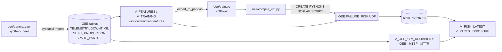

# OEE Command Center on Exasol Personal

Predictive maintenance and OEE analytics for a multi-plant machine fleet, where
**the analytics and the model both run inside Exasol**: OEE, MTBF and MTTR are
SQL views, features are computed with window functions, and a gradient-boosted
failure-risk model is compiled into a dependency-free Python UDF that scores
every reading in-database.

Built for ExaThon India 2026, Track 03: Factories, Fleets & Supply Chains.

## Problem

**Who has it:** maintenance and production managers running mixed fleets of
CNC mills, lathes, presses and packing machines across several plants.

**The problem:** unplanned downtime arrives with no warning and no clear root
cause. Sensor telemetry, downtime logs, production counts and spare-parts stock
sit in separate systems, so nobody can answer three questions in one place:

1. Where is OEE being lost: availability, performance or quality?
2. Which machines are likely to fail in the next 24 hours?
3. Are the spare parts those failures will need actually at the right plant?

**Why it matters:** an unplanned stop costs hours of lost output, and a stop
that also waits on a part from another site costs days. Knowing risk 24 hours
ahead turns a breakdown into a planned intervention.

**Outcome:** one Exasol schema that answers all three questions, with every
number traceable to SQL.

## How it uses Exasol

| Capability | Where |
|---|---|
| Parallel bulk load via pyexasol HTTP import | `oee/load.py` |
| OEE (A×P×Q), MTBF, MTTR, inherent availability, downtime Pareto as SQL views, with correct weighting (components are summed, never ratios averaged) | `sql/02_oee_views.sql` |
| Feature engineering in-database with analytic window functions (`AVG … ROWS BETWEEN`, `LAG`) | `sql/03_features.sql` |
| Training labels in-database (unplanned stop within 24 h, correlated `EXISTS` + `ADD_HOURS`) | `sql/03_features.sql` |
| Model inference as a **PYTHON3 SCALAR UDF** on the stock script container | `oee/compile_udf.py` → `OEE.FAILURE_RISK` |
| Decision views joining risk × historical failure-mode mix × stock on hand | `sql/04_scoring.sql` (`V_PARTS_EXPOSURE`) |
| Model registry table | `OEE.MODEL_REGISTRY` |
| Live what-if scoring: the console calls `OEE.FAILURE_RISK` with edited inputs on every slider move | `oee/app.py` (`/api/whatif`) |
| Every console panel shows the exact SQL it ran on Exasol and how long it took | `oee/static/app.js` |

### Why the model is compiled into the UDF

XGBoost is trained outside the database, then its trees are flattened into
compact arrays and embedded with a ~50-line pure-Python scorer into a single
`CREATE PYTHON3 SCALAR SCRIPT` statement. That means:

- no BucketFS upload and no custom script language container to build;
- it runs on any Exasol Personal deployment with the standard python3 container;
- scoring happens where the data lives, in parallel UDF instances.

`tests/test_udf_parity.py` executes the generated UDF body and checks it against
`xgboost.predict_proba`: maximum absolute difference is below 1e-6 on the full
dataset.

## Architecture



## Quick start

Requirements: Python 3.10+, and Exasol Personal (local on macOS / Linux / Windows,
or on AWS / Azure).

```bash
# 1. Exasol Personal (local)
curl https://www.exasol.com/install/ | sh      # installs the `exasol` launcher
exasol install local
exasol slc install python3                     # local installs ship without UDF runtimes
exasol info                                    # shows the DSN to connect to

# 2. This project
git clone <this repo> && cd exasol-oee-command-center
python -m venv .venv && source .venv/bin/activate
pip install -r requirements.txt
cp .env.example .env                           # set EXA_DSN from `exasol info`

# 3. Run the whole pipeline
python -m oee.cli all
```

Then open the console:

```bash
python -m oee.cli serve        # http://127.0.0.1:8000
```

`all` runs these steps, which can also be run one at a time:

| Command | What it does |
|---|---|
| `python -m oee.cli generate` | Writes the synthetic dataset to `data/generated/` |
| `python -m oee.cli setup` | Creates the schema, loads the data, creates OEE / reliability / feature views |
| `python -m oee.cli train` | Pulls `OEE.V_TRAINING` from Exasol, trains XGBoost, writes `models/` |
| `python -m oee.cli deploy` | Compiles the model into `OEE.FAILURE_RISK`, scores every reading, builds decision views |
| `python -m oee.cli status` | Prints plant OEE, highest-risk machines and spare parts at risk |
| `python -m oee.cli serve` | Starts the web console |

## The console

A dark control-room console served by FastAPI, reading Exasol through `pyexasol`.

- **Top bar**: database status, the timestamp of the latest data, and how many
  readings the UDF has scored in Exasol.
- **Sensor feed**: hourly history for the selected machine (vibration, tool
  wear, temperature gap, torque, risk). Readings the model scored at 50% or
  more are drawn red and boxed, stops are shaded, and the dashed line is the
  normal for that machine type. The strip underneath shows all 60 days; click
  it to move the 7-day window.
- **Plant floor**: every machine on every line, coloured by its current
  24-hour risk (healthy under 10%, watch 10–50%, critical 50%+).
- **Diagnosis**: the model's risk, the likely failure mode (the machine type's
  failure history re-weighted by which signals are abnormal now), the signals
  furthest from normal, a written finding with a recommended action, similar
  past repairs from technician notes, and stock of the needed parts at that
  plant. **Raise work order** writes a row to `OEE.WORK_ORDERS` in Exasol.
- **OEE line impact**: each line's A × P × Q and loss split, and what tomorrow's
  OEE looks like if the at-risk machines stop unplanned.
- **What-if lab**: change tool wear, vibration, temperature gap or torque on
  the latest reading (or use a preset like "Replace tool now") and the live
  UDF re-scores it.
- **Repair history library** and **fault pipeline** (detect, diagnose, parts,
  work order), plus an **active alerts** ticker.
- Every panel shows **⛁ show SQL**: the exact queries it ran on Exasol and
  their run time.

The demo dataset has two planted problems for the console to surface: Chennai
line 2 runs slow (a performance loss), and press CHN-PRESS-03's scrap rate
climbs over the period (a quality loss).

## Data

All data is synthetic, generated by `oee/generate.py` (seeded, reproducible):
24 machines across Pune, Bengaluru and Chennai, 60 days of hourly telemetry
(~34k readings), planned and unplanned stops with technician notes, per-shift
production counts, and spare-parts stock per plant. Failure behaviour follows
five competing modes (tool wear, heat dissipation, power, overstrain, bearing
vibration). See [THIRD_PARTY.md](THIRD_PARTY.md) for data provenance and licences.

## Model

Binary classifier: *will this machine have an unplanned stop in the next 24 hours?*
Time-based split (last 20% of the period held out). On the default seed:

| Metric | Value |
|---|---|
| Test ROC AUC | 0.81 |
| Test average precision | 0.49 |
| Precision in top 5% of risk | 0.67 (base rate 0.086, ~8× lift) |
| Brier score | 0.058 |
| Mean predicted risk vs actual failure rate | 0.081 vs 0.086 |

The model is trained without class re-weighting so its scores stay
calibrated: the console shows risk as a probability, and readings scored
above 50% are followed by an unplanned stop about 69% of the time.

These figures are on synthetic data and show the pipeline works end to end;
they are not a claim about real plant performance.

## Repository layout

```
oee/
  generate.py      synthetic data generator
  features.py      feature contract (FEATURES) + pandas reference implementation
  train.py         XGBoost training and evaluation
  scorer.py        pure-Python tree scorer (embedded into the UDF)
  compile_udf.py   booster -> CREATE PYTHON3 SCALAR SCRIPT
  load.py          CSV -> Exasol via pyexasol
  sqlrun.py        SQL file runner (handles UDF '/' terminators)
  db.py            connection settings
  cli.py           pipeline commands
  app.py           FastAPI console backend
  assess.py        per-machine verdicts: status, likely mode, parts, pipeline stage
  static/          console front end (HTML, CSS, JS; charts are hand-drawn SVG)
sql/
  01_schema.sql  02_oee_views.sql  03_features.sql  04_scoring.sql
tests/             pytest suite (data, features, SQL contract, UDF parity, console API)
```

## Tests

```bash
pytest -q
```

The suite runs offline (no database needed): generator determinism and
integrity, OEE component bounds, label correctness, SQL ↔ Python feature
contract, the SQL statement splitter, UDF ↔ XGBoost parity, and the console
API. The API tests run the project's own SQL files on DuckDB as a stand-in
(`tests/fakedb.py`), which also checks the view logic: for example, that the
three losses and productive time add up exactly to planned time. The
application itself always runs on Exasol.

## Licence

MIT, see [LICENSE](LICENSE). Exasol Personal itself is proprietary software,
free for personal use under its own EULA.
