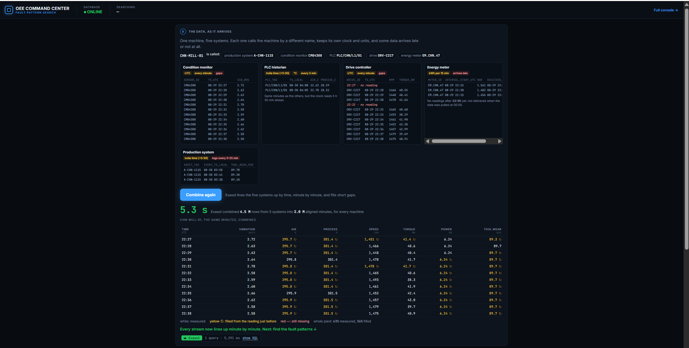
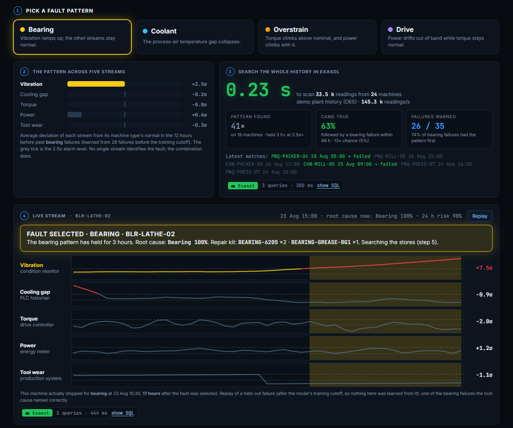
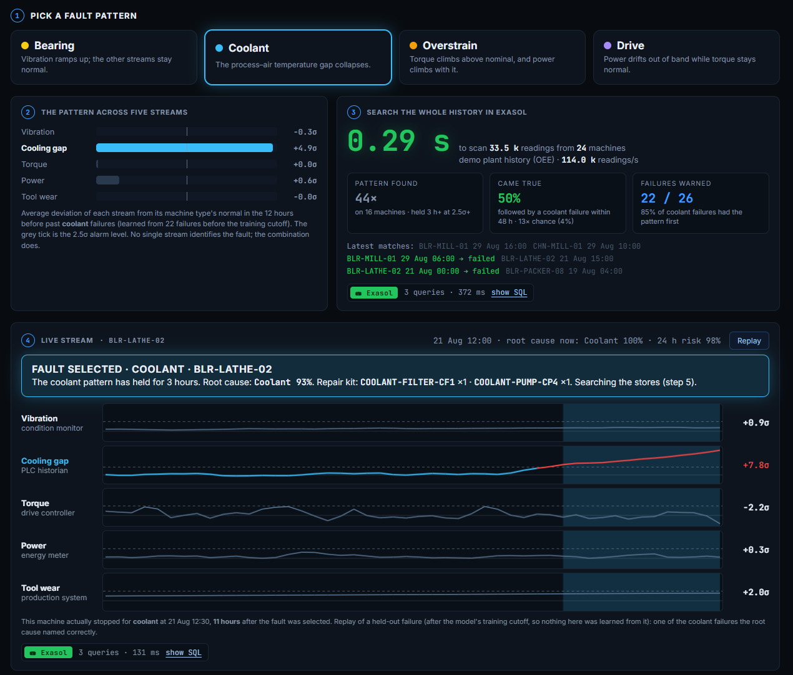
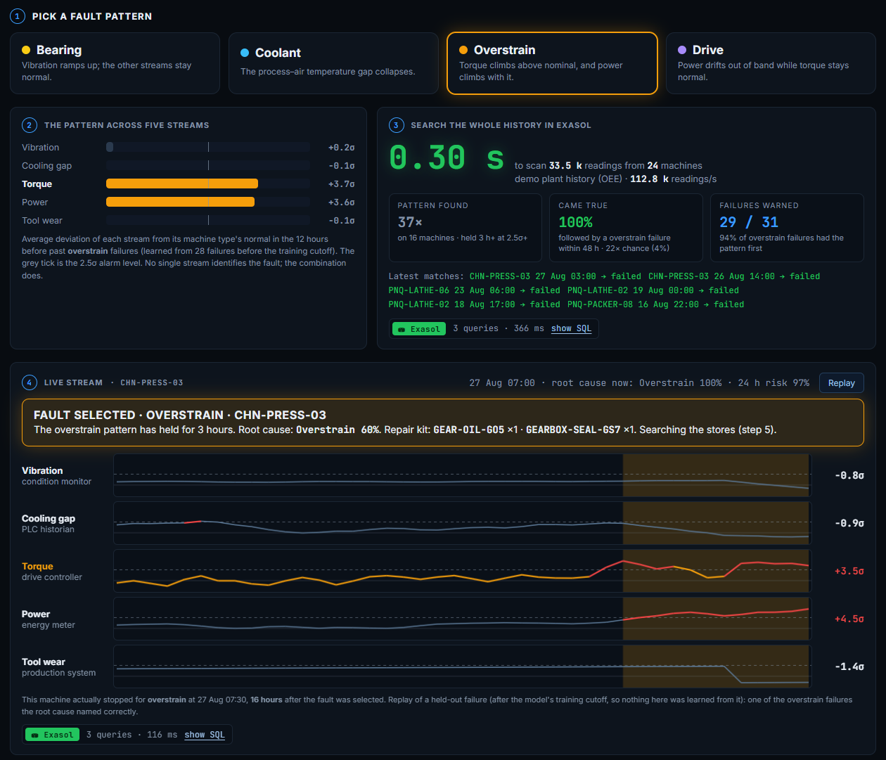
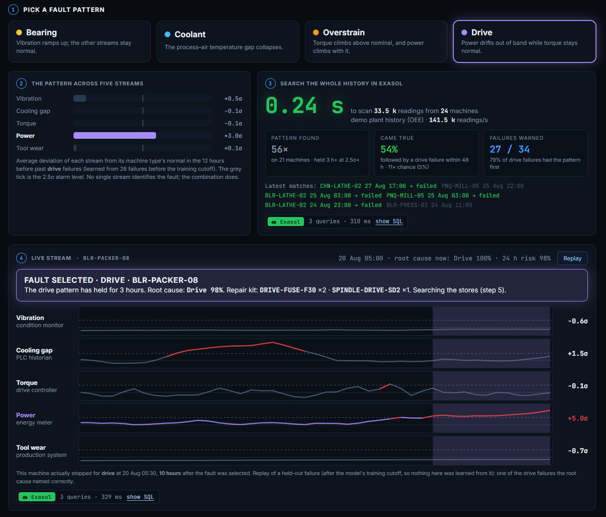
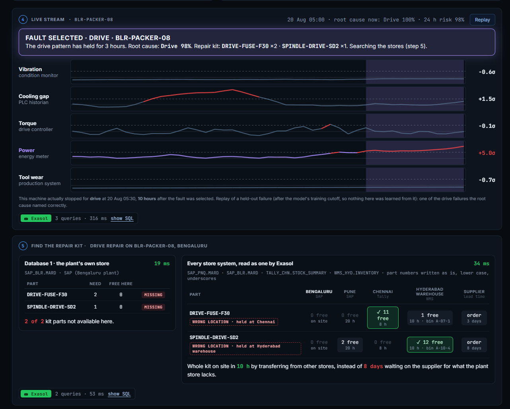
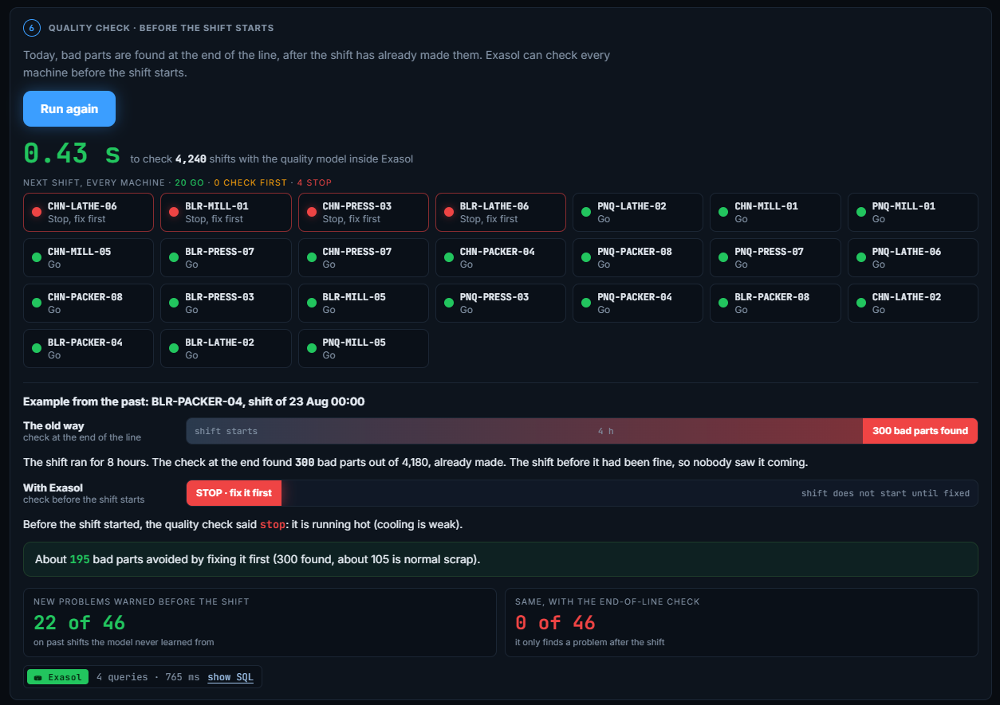
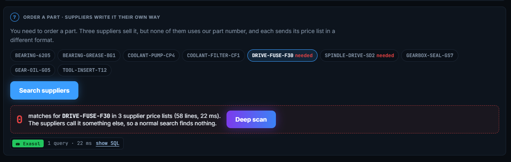
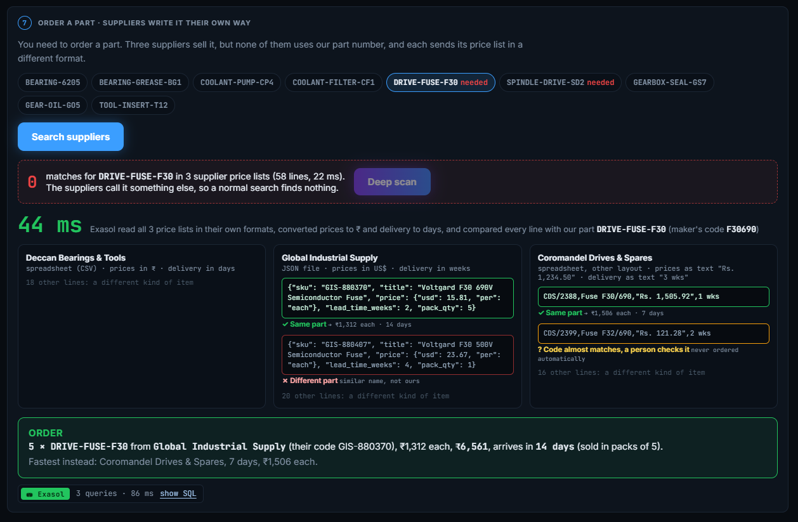
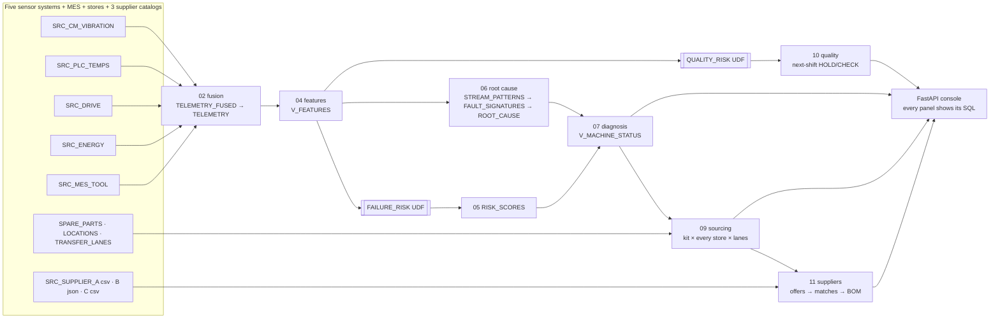

<div align="center">


### Sensor fusion, root cause, parts, quality and suppliers, all inside Exasol

**ExaThon India 2026 · Track 03: Factories, Fleets & Supply Chains**
Mrinal Prakash Desai · Team size 1

[](PROBLEM_STATEMENT.md)
[](RUN_GUIDE.md)
[](https://youtu.be/EhW4fQo-oj4)
[](docs/pitch-deck.pdf)
[](LICENSE)


</div>

---

> **The problem.** A maintenance manager running three plants can't stop a breakdown before it happens, because the warning signs, the spare parts and the supplier price lists are scattered across systems that each describe the same machine and part differently. **If this worked**, he would know which fault is coming hours before the line stops, with the right part already on its way from wherever it sits.

A plant group's machine data is split across five systems that disagree on names,
clocks and units. OEE Command Center hands all of it to Exasol, which **combines**
it minute by minute, **names the fault** from its pattern across the streams hours
before the stop, **finds the repair kit** wherever it sits across four store
systems, **checks quality before the shift** starts, and **reads three supplier
price lists** in three formats to build the order. Every number on screen comes
from a query that has just run, and each panel shows that SQL and its run time.

[](https://youtu.be/EhW4fQo-oj4)

<p align="center"><b><a href="https://youtu.be/EhW4fQo-oj4">▶ Watch the 3-minute demo</a></b></p>

---

## Submission

| | Item | Where |
|---|---|---|
| ✅ | **Problem statement**: who has the problem and why it matters | **[PROBLEM_STATEMENT.md](PROBLEM_STATEMENT.md)** |
| ✅ | **Public code repository** | **[github.com/MrinalDesai/exasol-oee-command-center](https://github.com/MrinalDesai/exasol-oee-command-center)** |
| ✅ | **Pitch deck** (PDF) | **[docs/pitch-deck.pdf](docs/pitch-deck.pdf)** |
| ✅ | **Demo video**, under 3 minutes | **[youtu.be/EhW4fQo-oj4](https://youtu.be/EhW4fQo-oj4)** |
| ✅ | **README**: overview, setup, usage | **this page**: [overview](#the-five-problems-five-buttons) · [setup](#quick-start) · [usage](#the-demo-step-by-step) |
| ✅ | **Deployment instructions and run guide** | **[RUN_GUIDE.md](RUN_GUIDE.md)** (Windows, every command in order) · [Quick start](#quick-start) |
| ✅ | **Licence** | **[MIT](LICENSE)** |

> [!IMPORTANT]
> **Runs on your own machine in about 30 minutes.** Exasol Personal is free; the
> data is generated, so no accounts or keys are needed. **All data is synthetic**,
> generated to mirror a real multi-plant shop floor; no employer or proprietary
> data is used. Follow
> [RUN_GUIDE.md](RUN_GUIDE.md), then open **http://127.0.0.1:8000/demo**.

---

## The doctrine

> ### Combine first. Let the pattern name the cause. Keep the work where the data is.

| Principle | In practice |
|---|---|
| **Combine first** | No model sees raw sources. Exasol maps IDs, clocks and units, and fills short gaps, flagging every value as measured, filled or missing. The same model on raw-joined data alarms on 97% of hours; on the combined data, on 9%. |
| **The pattern names the cause** | No single stream names a fault (overstrain and a drive fault both raise power). The combination across five streams does, and every pattern is checked against history: how often it came true. |
| **Keep the work where the data is** | XGBoost models are compiled into Python UDFs and called from SQL. Root cause, stock search and supplier matching are SQL. Nothing leaves the database to be scored. |

---

## The five problems, five buttons

| # | Track 03 problem | Press | What Exasol does |
|---|---|---|---|
| **0** | **Operational data that is delayed, distributed, incomplete** | **Combine** | Lines five sensor systems up by time, minute by minute, and fills short gaps |
| **1–4** | **Unplanned downtime with no clear root cause** | **Bearing · Coolant · Overstrain · Drive** | Shows the fault's five-stream pattern, searches the whole history for it, timed, then replays an unseen machine until the pattern selects the fault |
| **5** | **Spare parts held in the wrong location** | *(follows the fault)* | Searches the plant store, then all four store systems as one; flags wrong-location stock and the fastest way to site |
| **6** | **Quality issues caught at the end of the line** | **Run quality check** | Scores every shift with a model UDF before it starts: Go, Check first or Stop |
| **7** | **Suppliers reporting in inconsistent formats** | **Search suppliers → Deep scan** | Reads a CSV, a JSON file and a messy CSV in their own formats, matches the part and builds the order line |

---

## The demo, step by step

> [!NOTE]
> All screenshots are from Exasol Personal running locally on a Windows laptop.
> Nothing is pre-computed for the page: every number is computed by Exasol when the
> button is pressed, and each panel's **show SQL** link shows the exact queries and
> their run time.

### 0 · The data, as it arrives, then Combine

*Screenshot at the top of this page.* One machine as five systems see it: five different names for the same machine,
two clocks (UTC and India time), temperatures in °C, energy in 15-minute blocks
that arrive hours late, and missing minutes. **Combine** runs the real fusion SQL
for the whole plant: Exasol lines every system up by time, minute by minute, and
fills short gaps. **4.5 M rows from 5 systems into 2.0 M aligned minutes in 5.3 s.**
White values were measured, yellow ↻ values were filled from the reading just before.

### 1–4 · Unplanned downtime with no clear root cause

Each fault leaves its own pattern across the five streams. No single stream
names the fault; the combination does. Pick a fault and Exasol (2) shows its
pattern, (3) searches the whole history for it, timed, and checks how often it
came true, then (4) replays a machine the model never trained on until the same
pattern selects the fault, hours before the real stop (each screenshot shows the
machine and the lead time).

| Fault | Pattern | Found in history | Came true (followed by that failure within 48 h) | Failures warned |
|---|---|---|---|---|
| **Bearing** | vibration ramps up, the rest stays normal | 41× | 63% (13× chance) | 26 of 35 |
| **Coolant** | the process–air temperature gap collapses | 44× | 50% (13× chance) | 22 of 26 |
| **Overstrain** | torque and power climb together | 37× | **100%** (22× chance) | 29 of 31 |
| **Drive** (motor drive) | power drifts out of band, torque stays normal | 56× | 54% (11× chance) | 27 of 34 |

<table>
<tr><td></td><td></td></tr>
<tr><td align="center"><b>Bearing</b></td><td align="center"><b>Coolant</b></td></tr>
<tr><td></td><td></td></tr>
<tr><td align="center"><b>Overstrain</b></td><td align="center"><b>Drive</b></td></tr>
</table>

### 5 · Spare parts held in the wrong location



> [!TIP]
> **Plant store first, then the network.** This is the "wrong location" problem
> made visible: the parts exist, just not where the machine is.

The drive repair on BLR-PACKER-08 needs two parts. Exasol first searches the
plant's own store system (SAP, Bengaluru): **both missing**. It then reads all four
store systems as one (SAP Pune, SAP Bengaluru, Tally Chennai, WMS Hyderabad, each
with its own layout and its own way of writing part numbers), flags each part as
**WRONG LOCATION**, and picks the fastest source: **the whole kit on site in 10 h,
instead of 8 days waiting on the supplier.** Both searches are timed (19 ms, 34 ms).

### 6 · Quality issues caught at the end of the line



Today, bad parts are found at end-of-line inspection, after the shift has made
them. **Run quality check** scores every shift with `OEE.QUALITY_RISK`, a model
compiled into an Exasol UDF (4,240 shifts in 0.43 s), and gives each machine's next
shift **Go, Check first or Stop**. In the example, the old way found 300 bad parts at
the end of the shift; the check said stop before it started (the machine was
running hot). On shifts the model never learned from, it warned before **22 of 46
new quality problems**; the end-of-line check, by definition, before none.

### 7 · Suppliers reporting in inconsistent formats



A normal search for our part number finds **0** lines: none of the three
suppliers uses it.



**Deep scan** reads all three price lists in their own formats (a CSV in rupees and
days, a JSON file in dollars and weeks, a CSV with prices like "Rs. 1,234.50" and
delivery like "1 wks"), converts them, and judges every line: the same part, a
different part with a similar name, or a near match that a person must check.
Then it builds the order line.

> [!NOTE]
> Near matches are never ordered automatically. A 6204 bearing listed next to our
> 6205 looks almost identical as text; the deep scan marks it **ASK** for a person
> to check, instead of guessing.

---

## The problem, in detail

A plant group with 24 machines (CNC mills, lathes, presses, packers) across Pune,
Bengaluru and Chennai, and a regional parts warehouse in Hyderabad.

| Track 03 challenge | What it looks like here | What Exasol does | Where |
|---|---|---|---|
| **1. Operational data that is delayed, distributed, incomplete** | Every machine's sensors sit in five systems: condition monitoring (vibration), PLC historian (temperatures), drive controller (speed, torque), energy meters (power, delivered hours late), MES (tool wear). Each system has its own machine IDs, clock, units and gaps | Maps the IDs, converts local time to UTC and °C to K, spreads 15-minute energy readings over their minutes, ignores meter data that has not arrived yet, fills short gaps (each value flagged measured, filled or missing), giving one minute-by-minute table | `sql/02_fusion.sql` |
| **2. Unplanned downtime with no clear root cause** | Five failure modes. No single sensor names the fault (overstrain and a drive fault both raise power) | One detector per stream per machine-hour, matched against fault signatures learned from past failures: **the pattern combination names the root cause** | `sql/06_root_cause.sql` |
| **3. Spare parts held in the wrong location** | The plant next to a failing machine often lacks the kit | Looks up the repair kit for the root cause, scans every store, compares road transfer with supplier lead time, reserves the kit when a work order is raised | `sql/09_sourcing.sql` |
| **4. Quality issues caught at the end of the line** | End-of-line inspection finds scrap after the shift made it | `OEE.QUALITY_RISK`, a model UDF, scores the **next** shift from the machine's condition now | `sql/10_quality.sql` |
| **5. Suppliers reporting in inconsistent formats** | A CSV in rupees and days, JSON in dollars and weeks, a CSV with "Rs. 1,234.50" and "3 wks". Nobody uses our part numbers | Reads all three, normalises descriptions, matches manufacturer codes, sends near-misses (typos, a 6204 bearing next to our 6205) to review, and builds the **BOM to order** | `sql/11_suppliers.sql` |

## Results

> [!WARNING]
> **Synthetic data.** These numbers show the method works end to end on a
> generated plant with known ground truth. They are not real plant performance.

Measured on Exasol Personal (local, Windows), on held-out data only (after each
model's training cutoff), default dataset (`all`, seed 42, 60 days). Deploy steps
05–11 run in about 5 seconds in total; combining the five sensor systems takes
about 5–11 s depending on the machine.

| Step | Result | Compared with |
|---|---|---|
| 1. Combine & complete | 99.2% of the minute grid filled, from 4.5 M raw source rows. The same model alarms on **9% of hours with 72% precision**, and warned before 32 of 36 stops | raw sources joined at their reported timestamps: alarms on 97% of hours, 12% precision |
| 2. Root cause | **86%** of held-out failures named correctly (97% in the top two), on average **17 h** before the stop | guessing the commonest mode: 44% |
| 3. Parts sourcing | Example in the demo: drive kit for BLR-PACKER-08, both parts missing at the plant, **on site in 10 h** by transfer from Chennai and Hyderabad | 8 days waiting on the supplier |
| 4. Quality ahead | **48%** of *new* quality problems flagged before the shift starts; 81% of all bad shifts flagged, 62% precision | inspection rule "last shift was bad": 0% of new problems, 66% of all bad shifts, 66% precision |
| 5. Supplier BOM | 58 catalog lines from 3 formats: **21 of 21 automatic matches correct**, 91% recall; 4 near matches sent to review (1 real) | |

The 24-hour failure model (XGBoost, 200 trees) has test ROC AUC 0.84. The
quality model has test ROC AUC 0.94.

## How it uses Exasol (the five pillars)

| Pillar | How this project uses it | Evidence |
|---|---|---|
| **In-memory MPP** | The fleet-scale bench scores ~14 M one-minute readings with a numpy `SET` UDF that Exasol runs as parallel instances across all CPU cores | `python -m oee.cli bench` → `OEE.BENCH_RUNS` |
| **Columnar storage & compression** | Raw source tables of mostly-repeating IDs and timestamps | `python -m oee.cli pillars` reads `EXA_ALL_OBJECT_SIZES` |
| **Self-tuning** | No index, partition or hint anywhere in `sql/`. Exasol builds what the joins need | `pillars` reads `EXA_DBA_INDICES` |
| **High concurrency** | The console is many small queries; `pillars` runs 1, 4, 8 and 16 sessions of the five-step query mix at once | `OEE.PILLAR_EVIDENCE` |
| **In-database AI / UDFs** | `OEE.FAILURE_RISK`, `OEE.FAILURE_RISK_BATCH` and `OEE.QUALITY_RISK`: XGBoost models compiled into Python UDFs, called from SQL. Root cause, sourcing, supplier matching (`EDIT_DISTANCE`, `JSON_VALUE`, `REGEXP_*`) are SQL | `oee/compile_udf.py`, `sql/05`–`11` |

All five are shown in the console's **Fleet Scale** panel.

<details>
<summary><b>Why the models are compiled into the UDFs</b></summary>

<br>

XGBoost is trained outside the database. Its trees are then flattened into
arrays and embedded, with a short pure-Python scorer, in a single
`CREATE PYTHON3 SCALAR SCRIPT` statement:

- there is no BucketFS upload and no custom script container (xgboost is not
  in the stock container);
- it runs on any Exasol with the standard python3 container;
- scoring happens where the data lives.

`tests/test_udf_parity.py` checks the UDF against `xgboost.predict_proba`
(difference below 1e-5).

</details>

## Architecture



## Quick start

> [!TIP]
> **On Windows, use [RUN_GUIDE.md](RUN_GUIDE.md)**: the same steps as copy-paste
> PowerShell blocks, with downloads separated from running.

Requirements: Python 3.10+, Git, and Exasol Personal (local on Windows, macOS or
Linux, or on AWS or Azure).

```bash
# 1. Exasol Personal (local)
#    macOS / Linux: curl https://www.exasol.com/install/ | sh
#    Windows: download the launcher from https://downloads.exasol.com/exasol-personal (see RUN_GUIDE.md)
exasol install local
exasol slc install python3                     # local installs ship without UDF runtimes
exasol info                                    # shows the DSN to connect to

# 2. This project
git clone https://github.com/MrinalDesai/exasol-oee-command-center && cd exasol-oee-command-center
python -m venv .venv && source .venv/bin/activate      # Windows: .venv\Scripts\activate
pip install -r requirements.txt
cp .env.example .env                           # set EXA_DSN from `exasol info`

# 3. Run the whole pipeline (about 2 minutes)
python -m oee.cli all
python -m oee.cli pillars                      # optional: pillar evidence for the console
python -m oee.cli serve                        # demo: http://127.0.0.1:8000/demo · console: http://127.0.0.1:8000
```

`all` runs these steps, which can also be run one at a time:

| Command | What it does |
|---|---|
| `python -m oee.cli preflight` | Checks this Exasol supports every SQL feature the project uses, and that no name clashes with a reserved word |
| `python -m oee.cli generate` | Writes the synthetic plant, sources and supplier catalogs to `data/generated/` |
| `python -m oee.cli setup` | Creates the schema, loads every source as delivered, combines and completes the sensor data, creates OEE and feature views |
| `python -m oee.cli train` | Pulls `V_TRAINING` and `V_QUALITY_TRAINING` from Exasol, trains both models |
| `python -m oee.cli deploy` | Compiles both models into UDFs, then runs steps 05–11 (scoring, root cause, diagnosis, fusion impact, sourcing, quality, suppliers) |
| `python -m oee.cli status` | Prints plant OEE, highest-risk machines and parts at risk |

Other commands: `bench` (fleet scale, below), `pillars`, `serve`.

After `bench`, the pattern search on the demo page (step 3) scans the full
~14 M one-minute readings instead of the demo plant's ~34 k hourly ones.

## Fleet scale

```bash
python -m oee.cli bench --machines 20 --days 30  # quick check first
python -m oee.cli bench                          # 100 machines x 100 days, one reading a minute
```

`bench` generates about **14 million one-minute sensor readings (~1 GB of CSV)**
and times each stage inside Exasol: load (`IMPORT`), sensor fusion (rolling
windows), pattern detection (`OEE.FAILURE_RISK_BATCH`, a numpy `SET` UDF run in
parallel per machine-day), alerts and validation. Timings go to
`OEE.BENCH_RUNS` and the console. Local Exasol Personal runs on one node, so the
parallelism here is across CPU cores; the same SQL runs unchanged on a cluster.

## The full console

<details>
<summary><b>Besides the demo page, a full control-room console</b></summary>

<br>

Besides the demo page, a dark control-room console (FastAPI + hand-written HTML/JS), reading Exasol
through `pyexasol`:

- **Sensor feed** for the selected machine, with risk-flagged readings boxed in red and stops shaded.
- **① Combine & complete**: the five source systems as delivered, how much of each stream was measured or filled, and the same model on raw-joined vs combined data.
- **② Root cause**: five stream lights for the machine, its pattern next to every learned fault signature, root-cause probabilities, and held-out accuracy.
- **③ Parts sourcing**: every source for every part of the kit (local, transfer, supplier), the fastest one ticked, and quick links to machines whose kit is elsewhere. Raising a work order reserves the kit in `OEE.PART_RESERVATIONS`.
- **④ Quality ahead**: HOLD / CHECK / RUN for each machine's next shift, and the model vs the inspection rule.
- **⑤ Supplier BOM**: the order list, and how each supplier wrote each part (exact match or review).
- **Fleet scale and the five pillars**, plant floor, diagnosis with technician notes, OEE line impact, a what-if lab that re-scores through the live UDF, repair history, fault pipeline, alerts.
- Every panel shows **⛁ show SQL**: the queries it ran on Exasol and their run time.

</details>

## Data

All data is synthetic, generated by `oee/generate.py`, `oee/sources.py` and
`oee/suppliers.py` (seeded and reproducible). No real or proprietary data is used.

- **Plant**: 24 machines, 60 days. Failures develop along a P-F curve: a fault
  starts, degrades for 18–48 hours and leaves its own footprint on the streams
  (coolant fault → cooling gap collapses, drive fault → power drifts, overload →
  torque and power climb, bearing defect → vibration ramps). Tool wear fails on
  accumulated wear. Scrap follows machine condition. There are two planted OEE
  problems: Chennai line 2 runs slow, and CHN-PRESS-03's scrap climbs over time.
- **Sources**: the true minute-by-minute physics is split across five systems with
  different IDs, clocks (UTC vs IST), units (°C vs K, kWh per 15 min), cadences,
  dropouts, outages and late delivery. The truth is never loaded; Exasol rebuilds it.
- **Parts**: repair kits per failure mode. Stock follows a stocking policy (each part
  has a home store; expensive parts sit at the regional warehouse) and lives in four
  separate store systems with their own layouts: `SAP_PNQ.MARD`, `SAP_BLR.MARD`
  (SAP-style), `TALLY_CHN.STOCK_SUMMARY` (Tally-style) and `WMS_HYD.INVENTORY` (a
  warehouse system with bin locations). These are synthetic tables named after common
  system types; no SAP or Tally software or data is used.
- **Suppliers**: three catalogs with the same parts written differently, plus
  near-miss items, a typo, an item with no usable code, and unrelated stock.
  `SUPPLIER_MATCH_AUDIT` holds the true mapping, used only for scoring the matching.

Data provenance and licences: [THIRD_PARTY.md](THIRD_PARTY.md).

## Repository layout

```
oee/
  generate.py   plant physics (machines, P-F faults, stops, shifts, stock)
  sources.py    splits the sensor truth into five source systems
  suppliers.py  part master and three supplier catalogs
  load.py       CSV -> Exasol IMPORT via pyexasol
  features.py   feature contract;  quality.py  next-shift model contract
  train.py      XGBoost training;  compile_udf.py / scorer.py / vscorer.py  model -> UDF
  pipeline.py   ordered deploy steps (shared by the CLI and the tests)
  preflight.py  Exasol feature and reserved-word checks
  pillars.py    compression, self-tuning, concurrency evidence
  scale.py      fleet-scale benchmark
  stores.py     the four store systems and their layouts
  patterns.py   SQL behind the demo page (pattern search, replay, kit search, deep scan)
  app.py, assess.py, static/   console and demo page (static/demo.*)
sql/
  01_schema  02_fusion  03_oee_views  03_stores  04_features  04_quality_features
  05_scoring  06_root_cause  07_diagnosis  08_fusion_impact
  09_sourcing  10_quality  11_suppliers
tests/          pytest suite
docs/screenshots/   the screenshots in this README
```

## Tests

```bash
pytest -q
```

101 tests, offline. They run the project's own SQL files on DuckDB as a stand-in
for Exasol (`tests/fakedb.py`, which translates the few dialect differences).
They check: fusion against the hidden truth; root-cause signatures and
held-out accuracy; that sourcing never offers stock that isn't there and that
reservations round-trip; that the quality UDF matches the trained model; that
unit conversions and supplier matching are right; UDF ↔ XGBoost parity; and
the console API. Two tests guard Exasol rules that DuckDB does not enforce: every
computed column must be named, and no name may be an Exasol reserved word (the list
in `tests/exasol_reserved.txt` comes from `EXA_SQL_KEYWORDS`). The application
itself always runs on Exasol, and `preflight` checks the Exasol-specific functions there.

## Licence

MIT, see [LICENSE](LICENSE). Exasol Personal itself is proprietary software,
free for personal use under its own EULA. Data provenance and third-party
licences: [THIRD_PARTY.md](THIRD_PARTY.md).

---

<div align="center">

**Built solo by Mrinal Prakash Desai**
ExaThon India 2026 · Track 03: Factories, Fleets & Supply Chains

</div>
